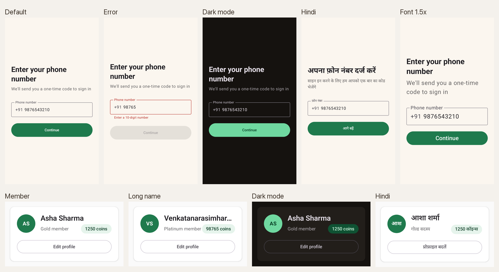
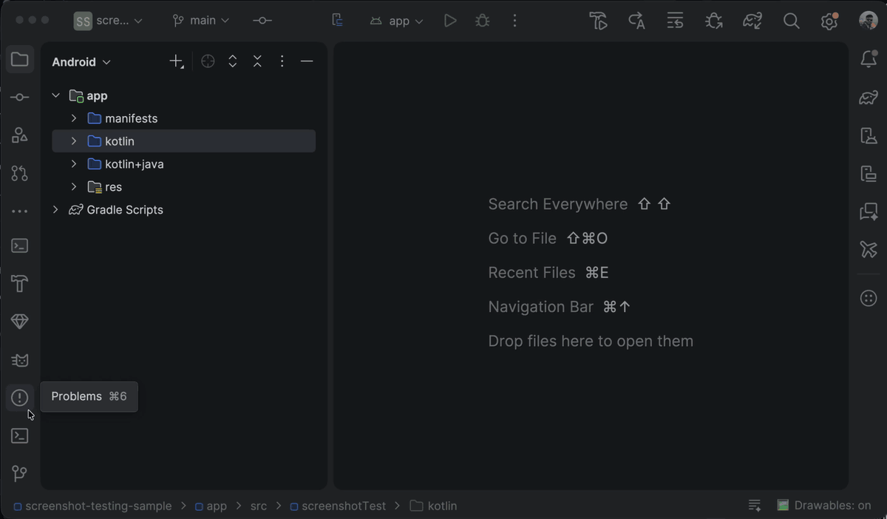

# Compose screenshot testing with AGP test suites

[](https://hacktoberfest.com)
[](CONTRIBUTING.md)

A minimal Android app showing **built-in screenshot testing** in the Android Gradle Plugin:
no Paparazzi, no Roborazzi, no extra Gradle plugin. Every `@Preview` annotated with
`@PreviewTest` is rendered on the JVM with Layoutlib and compared against a reference image.



12 screenshot tests cover two screens in the states that usually break: empty, filled, loading,
error, dark mode, Hindi, a 1.5× font scale and a very long name.

> **Experimental.** This needs an alpha AGP and a Canary Android Studio. Great for trying the
> feature on a branch; wait for a stable AGP release before using it in a production app.

## Run the tests

```bash
./gradlew :app:testDebugScreenshotTestDefaultTestSuite
```



All 12 tests run from the terminal and the build passes in about 22 seconds
([MP4 version](docs/test-run.mp4)).

## Requirements

| What | Version used here | Notes |
|---|---|---|
| Android Gradle Plugin | `9.5.0-alpha08` | 9.5.0-alpha03 or newer. |
| Gradle | `9.6.1` | AGP 9.5 alphas refuse anything older than 9.6.0. |
| Android Studio | Rabbit 2 (2026.2.2) Canary | Stable Studio will not sync an alpha AGP. The Gradle commands below work without it. |
| Screenshot engine | `0.0.1-alpha16` | |
| JDK | 17+ | |

## Run it

```bash
# Record (or re-record) the reference images
./gradlew :app:updateDebugScreenshotTestDefaultTestSuite

# Compare the current UI against them
./gradlew :app:testDebugScreenshotTestDefaultTestSuite
```

References live in `app/src/screenshotTestDefaultDebug/reference/` and are committed.
The HTML report (reference, new render and a highlighted diff for every test) is written to
`app/build/reports/tests/testDebugScreenshotTestDefaultTestSuite/index.html`.

Tip: the report loads its images by relative path, so serve it instead of opening the file:

```bash
python3 -m http.server 8765 --bind 127.0.0.1
# then open http://localhost:8765/app/build/reports/tests/testDebugScreenshotTestDefaultTestSuite/index.html
```

## Setup in your own project

**1. `gradle.properties`** - both flags are required, or the build fails at sync:

```properties
android.experimental.enableScreenshotTest=true
android.experimental.testSuiteSupport=true
```

**2. `app/build.gradle.kts`** - declare a screenshot test suite:

```kotlin
android {
    testOptions {
        screenshotTests.create("screenshotTest") {
            engineVersion = "0.0.1-alpha16"
            targetVariants.add("debug")

            dependencies {
                implementation(libs.androidx.compose.ui.tooling)
                implementation("com.android.tools.screenshot:screenshot-validation-api:0.0.1-alpha16")
            }
        }
    }
}
```

**3. `app/src/screenshotTest/kotlin/...`** - write previews and mark them as tests:

```kotlin
@PreviewTest
@Preview(widthDp = 360, heightDp = 640, locale = "hi")
@Composable
fun LoginFilledHindi() {
    SampleTheme { LoginScreen(LoginUiState(phone = "9876543210"), onPhoneChange = {}, onContinue = {}) }
}
```

See [`LoginScreenScreenshotTest.kt`](app/src/screenshotTest/kotlin/io/github/yogesh7/screenshottesting/ui/LoginScreenScreenshotTest.kt)
and [`ProfileCardScreenshotTest.kt`](app/src/screenshotTest/kotlin/io/github/yogesh7/screenshottesting/ui/ProfileCardScreenshotTest.kt).

## Lessons from trying it on a large production app

This sample is clean on purpose. Bringing the same setup to an existing multi-module app took
more than the two flags:

- **Use AGP's built-in Kotlin.** If a module still applies the standalone `org.jetbrains.kotlin.android`
  plugin (for example with `android.builtInKotlin=false`), Kotlin in `src/screenshotTest` is never
  compiled. The build passes, the task reports `NO-SOURCE`, and no screenshots are produced.
  This sample applies only the Compose compiler plugin.
- **Move kapt to KSP.** AGP's `com.android.legacy-kapt` leaves an unset classes directory on the
  screenshot test component, failing with *"Cannot query the value of this property because it has
  no value available"*.
- **Jetifier.** If `android.enableJetifier=true`, it crashes on the engine's `com.android.tools:common`
  jar. Skip it with `android.jetifier.ignorelist=common-3\\d\\.`.
- **Product flavors change the task names** - they are variant-first, e.g.
  `updateStagingDebugScreenshotTestDefaultTestSuite`, not the suite-first names in the docs.
  References go to `src/screenshotTest<Suite><Variant>/reference`.
- **Composables must be stateless to render.** Anything that reads a singleton, casts
  `LocalContext`/`LocalView` to an `Activity`, or checks the clock crashes in Layoutlib (and in
  Android Studio's preview). Pass that state in as parameters - the screens here take a
  `LoginUiState` / `Profile` for exactly this reason.
- **Pin values that change on their own.** Build version labels, "today" dates and countdowns
  invalidate references on every release or every day. Make them parameters and fix them in tests.
- **Layoutlib renders the first frame.** Animated values show their start value and GIFs are blank.
- **Dynamic-feature modules** are not covered by the docs and not verified here.

## It catches real bugs

The first version of `ProfileCard` put the coins badge next to the name. The very first recording
showed even "Asha Sharma" cut off as "Asha Shar..." on a 360dp screen. Moving the badge onto the
plan line fixed it, and `testDebugScreenshotTestDefaultTestSuite` then failed on all five profile
references until they were re-recorded - which is exactly the safety net you want.

## Hacktoberfest

This repo takes part in [Hacktoberfest](https://hacktoberfest.com). Good places to start:

- Add a screenshot test for a state that isn't covered yet (RTL, landscape, tablet width, another locale).
- Add a new small screen with its own `@PreviewTest` previews.
- Try the setup on a newer AGP or screenshot engine alpha and report what changed.
- Improve the docs, especially the lessons from real projects.

Look for issues labelled `hacktoberfest` or `good first issue`, and read [CONTRIBUTING.md](CONTRIBUTING.md)
before opening a PR.

## Learn more

- Official docs: [Compose screenshot testing with test suites](https://developer.android.com/studio/preview/compose-screenshot-testing-with-testsuites)
